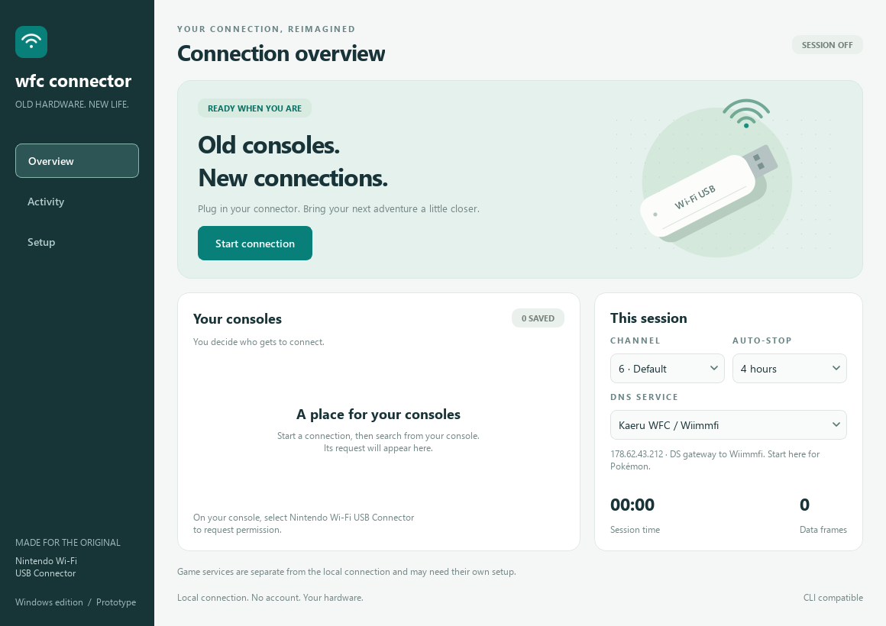

# WFC USB Connector for Windows

Connect a Nintendo DS to a community WFC service using the original Nintendo Wi-Fi USB Connector and a Windows 10 or 11 x64 PC. The desktop app lets you start a session, approve your console and choose its DNS service.

**Source preview.** A hardware test on Windows 11 reached Pokémon Pearl Mystery Gift with Kaeru WFC / Wiimmfi. Wii, multiplayer and long sessions still need testing. See the [hardware test report](docs/HARDWARE.md#successful-mystery-gift-test-2026-09-25).



## Start your first session

1. Plug in the original adapter and follow the [WinUSB driver guide](driver/README.md). Match USB ID `0411:008B` before replacing the driver.
2. Install 64-bit Python 3.12 with the Windows Python launcher. Download and extract the project source ZIP, then open PowerShell in the folder containing `gui.py`.
3. Install the app and network components in that folder:

   ```powershell
   py -3.12 -m venv .venv
   .\.venv\Scripts\python.exe -m pip install -r requirements-gui.txt
   .\.venv\Scripts\python.exe tools/fetch_slirp.py
   .\.venv\Scripts\python.exe gui.py
   ```

4. Select **Kaeru WFC / Wiimmfi** to try the configuration used for the Pokémon Pearl test, then click **Start connection**. On the console, select **Nintendo Wi-Fi USB Connector** in Nintendo WFC settings. Approve the pending console in the desktop app and run the console's connection test.
5. Stop the session when finished. The connector uses legacy WEP. For later sessions, run the last command again from the same folder.

Prefer PowerShell? Follow the [CLI instructions](#cli-setup-and-use). If you created the virtual environment above, use `.\.venv\Scripts\python.exe` wherever the instructions say `python`.

## Compatibility recorded on 2026-09-25

| Component | Status |
|-----------|--------|
| Registration protocol analysis | Documented in [PROTOCOL.md](docs/PROTOCOL.md) |
| SSID format and WEP key derivation | Verified against the emulated original x86 routine: 200/200 cases |
| WinUSB and RT2570 access | Tested on the local RT2570 rev. 5 / RF2525E adapter |
| Radio and SoftAP | Console discovery, approval, authentication, association and WEP tested on hardware |
| DHCP, DNS and Internet access | The tested console completed its connection test; DNS and TCP/HTTP verified |
| Pokemon Pearl: Mystery Gift | User confirmed it worked on 2026-09-25 after launching the desktop app; saved DNS: Kaeru WFC / Wiimmfi (`178.62.43.212`). See [test evidence](docs/HARDWARE.md#successful-mystery-gift-test-2026-09-25). |
| Other games, console models and long sessions | Not yet validated |
| Community DNS | Kaeru, WiiLink WFC and AltWFC passed DNS checks. Pokemon Pearl Mystery Gift confirmed with the Kaeru configuration; other services still need game tests. |
| Desktop interface | Optional native app: start/stop, console permissions, DNS selection, activity and setup |
| Rust port | Planned |

See [HARDWARE.md](docs/HARDWARE.md) for test evidence and known hardware issues,
and [RE-NOTES.md](docs/RE-NOTES.md) for reverse-engineering references.

## Requirements

- Windows 10/11 x64; the hardware test was performed on Windows 11.
- Nintendo Wi-Fi USB Connector, USB ID `0411:008B`, bound to WinUSB.
- Python 3.12 x64.
- Internet access for the PC and for the initial dependency downloads.

Follow the [WinUSB setup instructions](driver/README.md) first. Installing the
driver requires elevation; running the AP after that does not require an
administrator PowerShell window.

## Desktop app (optional)

The desktop app is an additional interface to the existing CLI. The CLI remains
available with its original commands and does not require Qt or any desktop
dependencies. Both interfaces share the SSID and console permissions in
`proto/state/`.

```powershell
python -m pip install -r requirements-gui.txt
python gui.py
```

- **Overview:** start or stop a connection, select the channel, session length and DNS service,
  approve or revoke consoles, and see session time and data frame counts.
- **Activity:** inspect or copy the current session log. Logs may contain console
  names and MAC addresses; review them before sharing.
- **Setup:** open the WinUSB guide or download and verify the network components.
  The app does not install drivers or change Windows networking settings.

Closing the window stops its own session and releases the adapter. If a CLI
session already owns the adapter, the app reports the conflict without stopping
that session. Only one desktop instance may use a given state directory.
`python gui.py --state PATH` selects an alternate directory; use the same
`--state PATH` global argument with the CLI to share its permissions.

Select **DNS service → Kaeru WFC / Wiimmfi** to try community DS services.
WiiLink WFC, AltWFC, WiiLink DNS and a custom IPv4 address are also available.
The choice is saved when starting a session; stop the connection before changing it.
Existing configurations retain Windows DNS. See [DNS services and test results](docs/DNS.md)
for the differences between services and their current limitations.
A "Radio active" status means the
AP is broadcasting; it is not a claim that a game's Internet service is available.

## CLI setup and use

Open PowerShell in the repository directory. Install dependencies once:

```powershell
python -m pip install -r requirements.txt
python tools/fetch_slirp.py
```

Connect the adapter and start the AP for four hours:

```powershell
python proto/ap.py run --channel 6 --seconds 14400
```

Keep this terminal open and the PC connected to the Internet. On the console,
select **Nintendo Wi-Fi USB Connector**. In a second terminal in the same directory:

```powershell
python proto/ap.py pending
python proto/ap.py allow AA:BB:CC:DD:EE:FF
```

Replace the example MAC with the console's address shown in the pending list.
Permission changes are loaded within a second. The console name is displayed
for convenience; permissions identify consoles by MAC address.

The SSID and permissions persist in `proto/state/`, which is excluded from Git.
An approved console does not need approval again after restarting the AP.
To revoke access:

```powershell
python proto/ap.py revoke AA:BB:CC:DD:EE:FF
```

Press `Ctrl+C` to stop the AP, or run this in another terminal:

```powershell
python proto/ap.py stop
```

Wait for `RADIO OFF` before starting another instance. The next start removes the
previous stop signal after opening USB exclusively. The AP also stops when
`--seconds` expires (300 seconds by default; maximum 86400).

### USB access errors

If you see `USBError: [Errno 13] Access denied`, first check whether another
instance is using the adapter. Stop it and wait for `RADIO OFF`, then retry.
Only one process can open the adapter at a time. If no other instance is running,
check the WinUSB assignment in Device Manager.

### Network settings

The guest network is `192.168.77.0/24`, with gateway `192.168.77.1`, DNS
`192.168.77.2` and DHCP leases starting at `.10`. Libslirp uses Windows sockets;
no ICS, TAP, Wintun, additional firewall rules or certificates are needed.
Incoming port forwarding to the console is not enabled.

The default `--dns system` resolves A/AAAA records through Windows using two
worker threads, without blocking USB processing. Other query types receive
NOTIMP. `--dns IPV4_ADDRESS` forwards console DNS queries over UDP using the same
bounded worker pool. It preserves the chosen service's replies and does not fall
back to Windows DNS on failure. TCP DNS and fragmented DNS replies are not supported.
The DNS path has been tested with a synthetic guest; successful game authentication,
gift downloads and multiplayer are separate checks.

For Kaeru WFC / Wiimmfi:

```powershell
python proto/ap.py run --channel 6 --seconds 14400 --dns 178.62.43.212
```

The console still receives `192.168.77.2` by DHCP; the app forwards its queries to
the selected service. No manual DNS changes are needed in the console's USB
Connector profile. CLI DNS selection is explicit and does not read desktop settings.

Use `--network none` to test registration and association without a network backend.

## Implementation and limitations

- Hidden SSID beacons, NWCUSBAP probes, explicit console approval, open-system and
  shared-key authentication, association and software WEP are implemented.
- The RT2570 destination filter dropped valid frames on the tested adapter.
  Broad reception is enabled by default; the program checks BSSID, allowed MAC
  addresses and association state before passing data to the network backend.
  `--no-monitor-rx` is available to investigate hardware filtering.
- Beacons use software timestamps and the Python event loop, with ASIC sequence
  numbering. The hardware beacon generator is disabled because testing was
  unstable. Transmission currently uses 1 Mbps for compatibility.
- Classic 802.11 data frames are supported. QoS, WPA and aggregation are not
  advertised; fragmented 802.11 frames are discarded.
- Shared-key authentication has been tested on a real console. PS-Poll/TIM has
  software tests. IPv6, TCP urgent data, inbound NAT, multiplayer/P2P and extended
  uptime have not been validated.
- Captures and unrelated traffic are not stored.

WEP is required for compatibility with this legacy protocol and does not provide
WPA2/WPA3-level protection. Keep the AP running only while it is needed.

## Validation

```powershell
python -m unittest discover -s tests -v
python -m compileall -q proto tests tools
python tools/check_network.py
python proto/diagnose.py --channel 6 --seconds 30
```

The automated tests cover registration, permissions, authentication, WEP,
frame handling and the real libslirp DLL's DHCP/ARP behavior. With desktop
dependencies installed, they also exercise permission buttons, navigation,
worker startup/shutdown and coexistence with CLI sessions. Desktop tests are
skipped when Qt is not installed. GitHub Actions checks the standalone CLI before
installing desktop dependencies, then runs the full suite on Windows x64 with
Python 3.12, without USB hardware.

`tools/check_network.py` additionally tests actual DNS and HTTP through the network backend
without USB. It depends on Internet access and the external connection-test
service. `proto/diagnose.py` opens the adapter for a bounded receive-only test;
stop the AP before running it. Automated checks do not replace console testing.

To repeat the published DNS survey or check the selected service through the backend:

```powershell
python tools/probe_dns.py
python tools/check_network.py --dns 178.62.43.212 --dns-only --host nas.nintendowifi.net
python tools/check_network.py --dns 178.62.43.212 --dns-only --host dls1.nintendowifi.net
```

The survey writes `runtime/dns-probes.json` with UTC time, response codes and
answers. Both tools work without USB hardware or Windows network changes.

## Repository layout

```text
docs/                 Protocol, hardware and reverse-engineering notes
gui.py                Optional desktop launcher
desktop/              Native Qt interface and CLI session controller
proto/
  ap.py               SoftAP and MAC permission commands
  rt2570.py           Userspace RT2570 driver over WinUSB/libusb
  wifi.py             802.11 frames, RC4/WEP and IE validation
  network.py          Windows libslirp DHCP/DNS/NAT backend
  wfckey.py           SSID format and WEP-104 key derivation
  verify_key.py       Original x86 routine verification with Unicorn
  diagnose.py         Bounded hardware reception test
tests/                Protocol and network tests
tools/                Runtime setup and Internet connectivity check
driver/               WinUSB setup instructions
re/                   Reverse-engineering helper scripts
```

`original/`, `runtime/`, `proto/state/`, downloaded reference sources, decompiler
output and packet captures are excluded from version control. Nintendo/Ralink
binaries and decompiled output must not be committed.

## Dependencies and licensing

CLI Python packages are pinned in `requirements.txt`; optional PySide6/Qt desktop
dependencies are listed in `requirements-gui.txt`. Their licenses are supplied
with the installed packages. The runtime setup downloads
MSYS2 packages with versions and SHA-256 hashes pinned in
`tools/slirp-packages.json`. Dependency licenses are extracted to
`runtime/ucrt64/share/licenses/`. Re-running setup preserves identical installed
files, including DLLs already loaded by the AP. Stop the AP before updating DLLs.

Only reproducing the original reverse-engineering checks requires the optional
packages `pefile`, `capstone` and `unicorn`; see [RE-NOTES.md](docs/RE-NOTES.md).

Original project code is available under the [MIT License](LICENSE). Third-party software retains its own licenses. Nintendo, Buffalo and Ralink names identify the hardware and software this independent project works with.

## Next steps

1. Extend the successful Pokemon Pearl Mystery Gift test to more games, console models and long sessions.
2. Investigate hardware filtering and transmission timing/reliability.
3. Validate the selected community WFC services with real games, including multiplayer.
4. Refine the desktop interface and consider a Rust port after stabilization.
